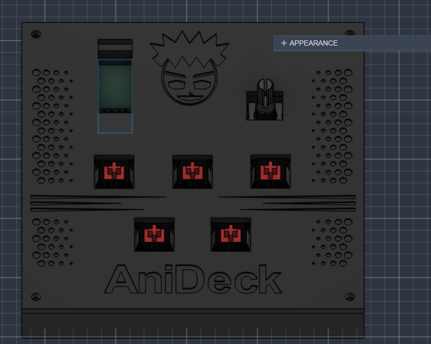
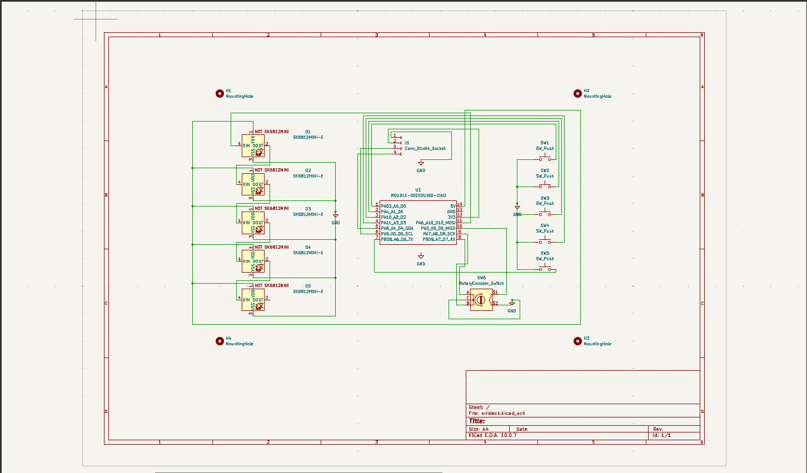
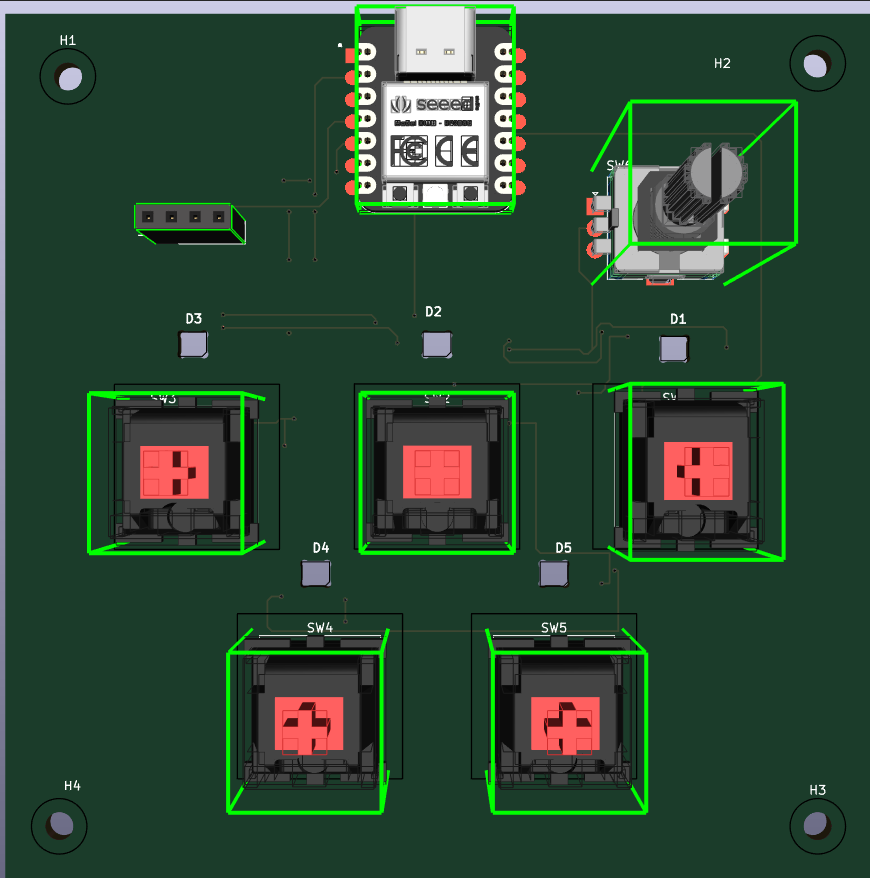
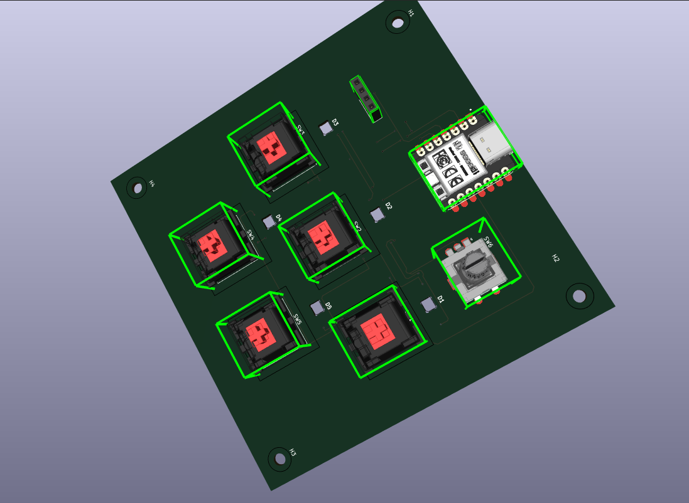
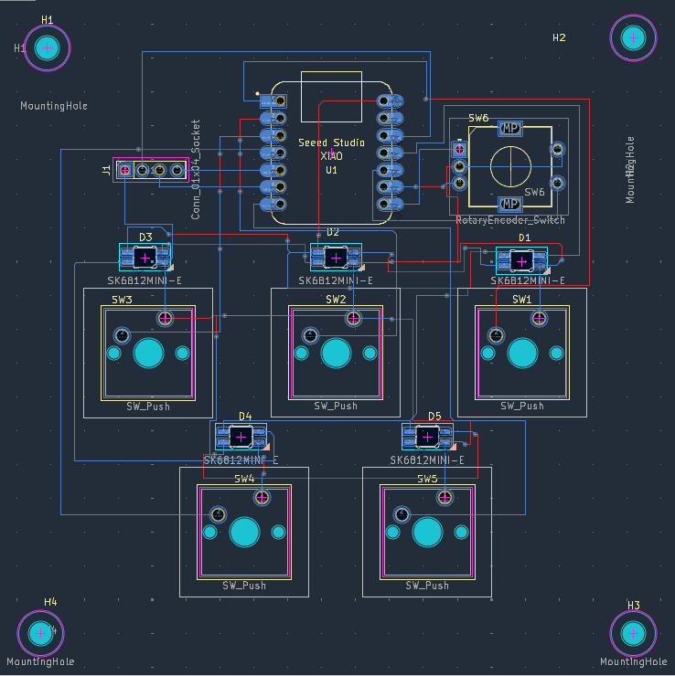

# AniDeck

AniDeck is a custom 5-key macropad featuring a rotary encoder and a 0.91" OLED display, designed specifically for an anime-focused workflow (optimized for the Anikoto platform). It runs KMK firmware on a Seeed Studio XIAO RP2040.

## Features
- **5-key macro layout** with custom shortcuts (Anikoto launcher, resume, play/pause, like, and audio toggle)
- **Rotary Encoder** for system volume control and mute
- **Seeed Studio XIAO RP2040** microcontroller

## CAD Model
The enclosure is a sandwich I designed it in Fusion360, consisting of 2 printed parts:
- Bottom case
- Switch plate

## PCB & Schematic
They both r designed in KiCAD. 

### Schematic

### PCB Layout & 3D Views

## Firmware Overview
- **Framework:** KMK firmware running on CircuitPython.
- **Keymap:** Custom macros and media controls tailored for anime streaming
- **Display:** Static text rendering via Adafruit Displayio libraries

## BOM (Bill of Materials)
Everything needed to build the AniDeck:
- 5× Mechanical switches
- 5× Keycaps
- 1× EC11 Rotary Encoder with push-button
- 1× 0.91" 128×32 OLED display
- 1× Seeed Studio XIAO RP2040
- 1× printed case (Bottom case, Switch plate)
- M3 bolts and heat-set inserts

## AI usage
- **As search engin:** Used to find sources to download different .step files for PCB.
- **Helped in KMK:** It helped me to write KMK firmware for my custom buttons.
- **NOTE:** didn't use it to create auto case not fully dependable on AI. 
